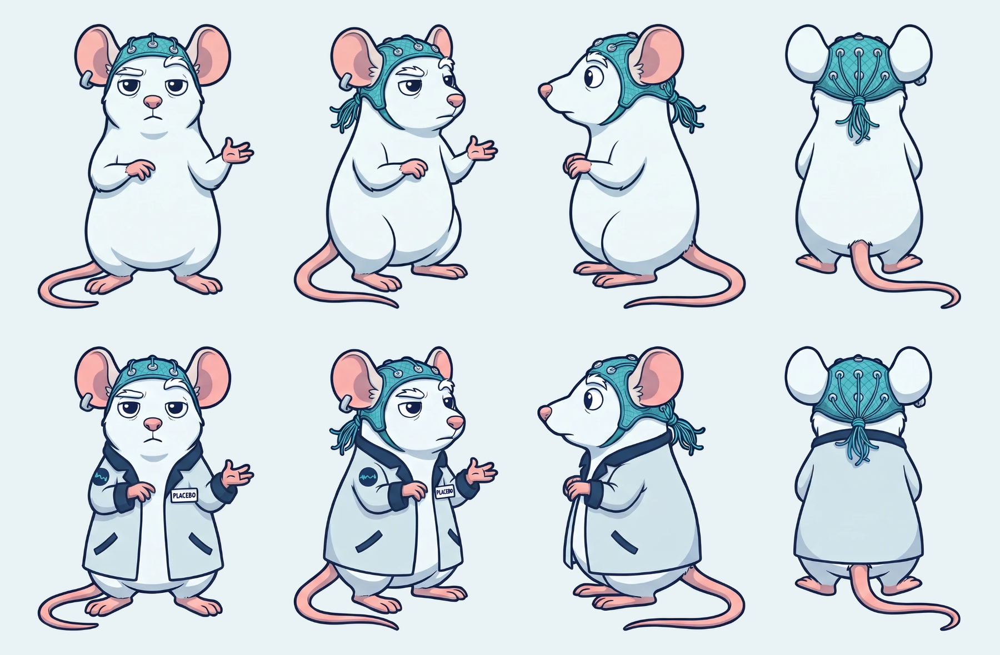

# Placebo: specyfikacja postaci

Wersja 1.1 · 17.11.2026 · status: robocza, do akceptacji Daniela. Specyfikacja opisuje oba warianty postaci (bez ubrania i w fartuchu), jej charakter, zasady użycia i pliki. Opiera się na arkuszach koncepcyjnych wygenerowanych przez AI, więc przed drukiem i licencjami wymaga finalnego zestawu wektorowego (punkt 12).

## 1. Karta postaci

| Pole | Wartość |
|---|---|
| Imię | Placebo |
| Gatunek | Szczur laboratoryjny albinos (biały), dorosły |
| Rola w marce | Przewodnik po dowodach i znak rzetelności Psyche Waves |
| Hasło | „Skąd to wiemy?” |
| Osobowość | Sucho, życzliwie, sceptycznie, cierpliwie. Mało słów. |
| Odbiorcy | Główni: dorośli i studenci psychologii. Poboczni: dzieci i rodzice (linia „Placebo Junior”). |
| Powiązanie z marką | Czapka EEG i turkus łączą go z falą Psyche Waves. Hasło uosabia „Ze źródłami.”. Nie zastępuje Wodnika (archetypu) ani logo. |
| Warianty | A: bez ubrania (domyślny). B: w fartuchu laboratoryjnym. |

Przegląd: górny rząd to wariant A (bez ubrania), dolny rząd to wariant B (w fartuchu); widoki od lewej: przód, trzy czwarte, profil, tył.



## 2. Osobowość i głos

- **Cechy:** deadpan, życzliwy sceptyk, kompetentny, cierpliwy. Mówi mało, reaguje głównie miną.
- **Czym nie jest:** lekarzem, terapeutą, mędrcem ani przeciwnikiem odbiorcy. Nie kpi z ludzi.
- **Dozwolone kwestie (do 8 słów):** „Skąd to wiemy?”, „Na kim to sprawdzono?”, „A grupa kontrolna?”, „Jeden przypadek to jeszcze nie badanie.”, „Poziom pewności?”, „Źródło?”.
- **Zakazane:** diagnozy, porady, „na pewno”, obietnice efektów, żarty z objawów, osób w kryzysie, substancji i uzależnień.
- **Humor:** wyłącznie z błędów myślenia, mitów, nagłówków i obietnic cudów.

## 3. Wizerunek bazowy (wspólny dla obu wariantów)

| Element | Opis |
|---|---|
| Sylwetka | Mały, pękaty, gruszkowaty. Stoi wyprostowany na tylnych łapach i gestykuluje przednimi jak mały wykładowca. Głowa z uszami ok. 35–40% wysokości sylwetki (bez ogona). |
| Futro | Białe z lodowym odcieniem, jeden miękki niebieskawy cień. |
| Uszy | Duże, okrągłe. Z zewnątrz łososiowy róż, wewnątrz ciemniejszy róż z jasnym kłaczkiem przy brzegu. |
| Nos | Mały, różowy. |
| Oczy | Okrągłe, ciemne, błyszczące, z białymi refleksami. W stanie domyślnym półprzymknięte powieki. |
| Brwi | Białe, puszyste, wyraziste. To główny nośnik emocji. |
| Łapy i stopy | Różowe, z wyraźnie zaznaczonymi palcami. |
| Ogon | Długi, różowy, gładki, wygięty miękką falą (echo fali EEG). |
| Znacznik w uchu | Mały srebrny kolczyk w uchu po **lewej stronie obrazu przy widoku z przodu** (to prawe ucho postaci). Opis wyjściowy mówił o „lewym uchu”, ale kanonem jest rysunek z arkusza. |
| Czapka EEG | Turkusowa (`#4FB3BF`), ściśle przylegająca siatka z drobnym wzorem rombów. Sześć do ośmiu okrągłych srebrnych elektrod. Cienkie turkusowe przewody zbiegają się z tyłu głowy w mały „kucyk”. Uszy wystają. |
| Kontur | Równy, granatowy (`#16304F`), nigdy czarny. Stała grubość w całej postaci. |
| Cieniowanie | Płaskie, cel-shading, jeden miękki cień. |
| Wyraz | Sucho, półprzymknięte oczy, uniesiona brew, ale życzliwie. |

### Asymetrie, których nie wolno psuć
Postać jest asymetryczna: kolczyk w uchu, naszywka i gest dłoni mają stałą stronę. **Nie odbijaj plików lustrzanie.**

## 4. Wariant A: bez ubrania (domyślny)

- Sam szczur z czapką EEG, bez żadnych ubrań, plakietek, napisów i logo (żadnego tekstu w ogóle).
- Używany wszędzie, gdzie nie ma powodu na wariant B: rolki, karuzele, strona, outro, naklejki, karty pracy dla dzieci, materiały Placebo Junior.
- Jedyny wariant dozwolony przy poważnych tematach (mina `h6-powaga`).

## 5. Wariant B: w fartuchu laboratoryjnym

| Element | Opis |
|---|---|
| Fartuch | Jasny szaro-niebieski (`#CCE4EC`, cień `#ACC4D4`), luźny, otwarty z przodu, sięga do dolnej części brzucha. Spod niego widać biały brzuch i stopy. |
| Klapy i mankiety | Szerokie klapy i szerokie mankiety w granacie (`#24456E`, ciemniejsze partie `#16304F`). |
| Kieszenie | Dwie ukośne kieszenie na dole, zaznaczone konturem. |
| Naszywka | Okrągła granatowa naszywka na piersi po **lewej stronie obrazu przy widoku z przodu**. Zawiera tylko turkusową falę EEG (`#4FB3BF`), bez tekstu. W produkcji zastąp ją dokładnym znakiem marki (punkt 4 skilla). |
| Plakietka z nazwą | Biała prostokątna plakietka z granatową ramką na piersi po **prawej stronie obrazu przy widoku z przodu** (naprzeciw naszywki), lekko przechylona w widoku 3/4. Napis: **PLACEBO**, wersaliki, gruby bezszeryfowy krój, granat (`#16304F`). To **jedyny napis dozwolony na postaci** (w wariancie A napisów nie ma wcale). Plakietka widoczna jest też na minach (głowa i ramiona) w prawym dolnym rogu. |
| Widok z tyłu | Gładki fartuch bez detali. Kucyk z przewodów leży na kołnierzu. |
| Bez zmian względem A | Czapka, kolczyk, uszy, ogon, proporcje, kontur. |

**Uwaga o napisie.** Napis „PLACEBO” na plakietce jest świadomym wyjątkiem od zasady „bez tekstu” w grafikach marki (zatwierdzony przez Daniela). Generatory obrazów często przekręcają litery: po każdej generacji sprawdź pisownię (P-L-A-C-E-B-O). Jeśli napis jest błędny, nie poprawiaj promptem w kółko, tylko nałóż poprawny napis w edycji.

### Kiedy używać wariantu B
- Kontekst badania, nauki i źródeł: prezentacje, warsztaty, prelekcje.
- Materiały „Skąd to wiemy?” z cytowaniem badań.
- Mediakit, oferta dla marek, plansza „Poziomy pewności”.
- Naklejki i produkty jako druga wersja postaci.

### Kiedy NIE używać wariantu B
- Przy tematach kryzysu, przemocy, uzależnień, psychozy, zaburzeń afektywnych i borderline.
- W treściach brzmiących jak porada, diagnoza lub terapia: fartuch mógłby sugerować uprawnienia lekarskie, a Daniel jest studentem i nie oferuje terapii.
- W materiałach dla dzieci o emocjach (tam wariant A).
- Nigdy ze stetoskopem, strzykawką, tabletkami ani innymi rekwizytami medycznymi.

## 6. Widoki (arkusz)

| Widok | Opis |
|---|---|
| Przód | Frontalnie, głowa na wprost. Jedna łapa uniesiona z otwartą dłonią do góry, druga przy brzuchu. |
| Trzy czwarte | Głowa lekko w bok, ten sam gest. Kucyk z przewodów widoczny z boku. |
| Profil | Wydłużony pyszczek, kucyk z tyłu, łapy złożone przy brzuchu, ogon wygięty długą falą. |
| Tył | Wzór siatki i przewody zbiegające się w kucyk. Uszy białe od tyłu. Ogon długi, wygięty falą. |

## 7. Miny

| Mina | Plik | Opis | Kiedy |
|---|---|---|---|
| Bez wrażenia | `h1-deadpan` | Półprzymknięte oczy, brwi równo, usta w poziomej kresce | Domyślna; obietnica cudu |
| Uniesiona brew | `h2-sceptyk` | Jedna brew w górze, oko zmrużone | „Skąd to wiemy?” |
| Ciepły uśmiech | `h3-usmiech` | Zamknięte oczy, szeroki łagodny uśmiech | Dobre pytanie, zakończenie, zaproszenie do działania |
| Zdziwienie | `h4-zdziwienie` | Szeroko otwarte oczy, otwarte usta | Badanie wyszło inaczej, niż zakładano |
| Dłoń na twarzy | `h5-facepalm` | Dłoń na czole, oko zamknięte | Wielkie wnioski z małej próby (nigdy przy osobach) |
| Poważnie i życzliwie | `h6-powaga` | Duże oczy, brwi lekko w górze, brak uśmiechu | Trudne tematy; jedyna mina dozwolona poważnie |

Miny istnieją w obu wariantach. Pliki wariantu A (głowa i górna część klatki) są przycięte w połowie klatki piersiowej i da się je wysuwać zza dolnej krawędzi kadru. W wariancie B widać pełne ramiona z klapami, naszywką i plakietką.

## 8. Paleta postaci

Wartości próbkowane z arkusza (przybliżone). W produkcji używaj kolorów marki tam, gdzie to możliwe.

| Element | HEX |
|---|---|
| Futro | `#ECF4FC` |
| Cień futra | `#B4C4D4` |
| Uszy, łapy, ogon, nos | `#F4B4AC` |
| Wnętrze ucha, cień różu | `#C48C94` |
| Czapka | `#4FB3BF` (w arkuszu ok. `#54BCC4`), cień `#44ACB4` |
| Elektrody | srebro, ok. `#C4D4E4` z granatowym konturem |
| Kontur | `#16304F` (w arkuszu bywa ciemniejszy, ok. `#14243C`) |
| Fartuch (B) | `#CCE4EC`, cień `#ACC4D4` |
| Klapy i mankiety (B) | `#24456E` / `#16304F` |
| Naszywka (B) | tło `#16304F`, fala `#4FB3BF` |

Zakazane: czerwień, fiolet, neony, czerń, wypełnienia przekolorowujące sierść.

## 9. Zasady graficzne

- **Tło:** mgła `#E9F3F6`, granat `#16304F` lub gradient marki. Biała sierść znika na czystej bieli.
- **Pliki PNG** mają jasną obwódkę (ok. 2 px), dzięki której postać czyta się na granacie.
- **Rozmiary minimalne:** miny (głowa) od 90 px szerokości, cała postać od 200 px wysokości, naklejka od 3 cm.
- **Strefa ochronna:** wokół postaci wolne pole równe szerokości jednego ucha.
- **Nie rób:** lustrzanych odbić, rozciągania, przekolorowywania, cieni rzuconych, dodawania napisów innych niż „PLACEBO” na plakietce wariantu B, ani ubrań i rekwizytów, przycinania postaci w połowie głowy.
- **Rolka 9:16:** poza strefami zasłanianymi przez interfejs (250 px od góry, 340 px od dołu).
- **Okładka:** pełne logo zostaje na okładce; Placebo nie zasłania logo, fali ani tytułu.
- **Tekst:** Placebo nie ma dymków z długim tekstem. Maksymalnie etykieta „Skąd to wiemy?”.

## 10. Zastosowania

| Kanał | Wariant | Poziom | Uwagi |
|---|---|---|---|
| Okładka karuzeli | A | Pełny lub lekki | Mina `h2-sceptyk`, w dolnej części kadru |
| Kadr Nauka | A | Pełny lub lekki | Mały znaczek przy poziomie pewności |
| Kadr Wniosek | A | Pełny | `h3-usmiech` w rogu |
| Outro wideo | A | Pełny | Cameo od dołu kadru, zmiana `h1` na `h2` |
| Strona `/placebo/`, `/sklep/` | A i B | – | B jako „lab” w kontekstach naukowych |
| Mediakit, oferta, warsztaty | B | – | Fartuch buduje poczucie rzetelności |
| Karty pracy dla dzieci | A | Łagodny | Miny `h3`, `h6`; bez sarkazmu |
| Poważne tematy | A | Poważny lub wcale | Tylko `h6-powaga` |

Poziomy użycia (pełny / lekki / poważny lub wcale) opisuje sekcja 12 SKILL.md.

## 11. Bezpieczeństwo i etyka

- Placebo nie jest lekarzem ani terapeutą i nie wygląda jak ich reklama.
- Szczur laboratoryjny nie jest przedstawiany jako ofiara eksperymentów. Nie używamy sformułowań typu „szczury doświadczalne” o ludziach.
- Nie żartujemy z osób, objawów, kryzysów, substancji, uzależnień i ludzi LGBTQ+.
- Treści o trudnych tematach zawsze mają linię pomocową i zastrzeżenie edukacyjne, bez względu na obecność Placebo.
- Karty dla dzieci: dla dorosłych pracujących z dziećmi, bez diagnozy, bez zbierania danych dzieci, z informacją o specjaliście i numerem 116 111.
- Współprace: partner nie zmienia postaci, nie dodaje jej rekwizytów ani tekstów i nie zatwierdza wniosków merytorycznych. Reklama zawsze oznaczona.

## 12. Prawa i status

- Arkusze zostały wygenerowane przez AI. Status autorski takich grafik jest niepewny i zależy od regulaminu narzędzia i własnego wkładu twórczego. Temat do prawnika.
- Nazwa „Placebo” jest powszechna (m.in. nazwa zespołu muzycznego). Przed sprzedażą sprawdzić znak w UPRP/EUIPO (klasy m.in. 9, 16, 25, 28, 41) i rozważyć nazwę złożoną („Placebo od Psyche Waves”) oraz znak graficzny postaci.
- Zalecany finalny zestaw wektorowy od ilustratora na podstawie arkusza, z umową przenoszącą prawa. Do czasu akceptacji arkusze służą jako wzór.

## 13. Pliki i nazwy

| Ścieżka (w skillu) | Zawartość |
|---|---|
| `assets/placebo/bez-ubrania/` | Przezroczyste PNG wariantu A: `front`, `tq`, `side`, `back`, miny `h1`–`h6` |
| `assets/placebo/fartuch/` | Przezroczyste PNG wariantu B z dopiskiem `-fartuch` (te same nazwy) |
| `assets/placebo/arkusz-bez-ubrania.webp` | Arkusz koncepcyjny wariantu A |
| `assets/placebo/arkusz-fartuch.webp` | Arkusz koncepcyjny wariantu B (wzorzec) |
| `assets/placebo/prompt-arkusz.txt` | Prompt bazowy |
| `assets/placebo/plansza-A-B.png` | Plansza porównawcza: wariant A i B, cztery widoki |
| `assets/placebo/SPECYFIKACJA.md` | Ten dokument |

W repozytorium ten sam zestaw leży w `materialy/placebo/` (foldery `bez-ubrania/` i `fartuch/`), a strona używa WebP z `public/placebo/` (wariant A).

## 14. Generowanie nowych póz

**Prompt bazowy** (wariant A) jest w `prompt-arkusz.txt`. Przy zmianach zachowaj opis postaci i styl bez zmian, zmień tylko pozę i kadr.

**Dodatek dla wariantu B** (doklej do opisu postaci, usuwając „No clothes” oraz „No text” z promptu bazowego, a „no text” zastępując wyjątkiem poniżej):

```
He wears an open, loose pale grey-blue (#CCE4EC) laboratory coat reaching the lower belly, with wide navy (#24456E) lapels and cuffs and two slanted lower pockets. On the chest, on the viewer's left, a small round navy (#16304F) patch with a turquoise (#4FB3BF) EEG wave and no text. On the viewer's right, a small white rectangular name badge with a thin navy border reading exactly "PLACEBO" in bold navy uppercase sans-serif letters (the only text anywhere on the character; spell it P-L-A-C-E-B-O). No other text, no logo, no stethoscope, no props.
```

**Kontrola jakości nowej grafiki (checklista):**
- Czapka EEG: turkus, siatka, elektrody, kucyk z przewodów z tyłu.
- Srebrny kolczyk w uchu po właściwej stronie.
- Kontur granatowy, bez czerni; brak czerwieni, fioletu, neonów.
- Brak jakiegokolwiek tekstu, liter, logo i znaków wodnych (wyjątek: napis „PLACEBO” na plakietce wariantu B, poprawnie napisany).
- Proporcje i kolory zgodne z arkuszem; ogon wygięty falą.
- Wariant B: fartuch z naszywką i plakietką „PLACEBO”, bez rekwizytów medycznych.
- Mina i gest zgodne z rolą Placebo i poziomem tematu.

## 15. Zgodność z plikami wzorcowymi (audyt)

Sprawdzone na przesłanych arkuszach (wariant A: `arkusz-bez-ubrania.webp`, wariant B: `arkusz-fartuch.webp`) i na prompcie bazowym.

| Wymóg z promptu lub arkusza | Wynik |
|---|---|
| Cztery widoki w jednej skali (przód, trzy czwarte, profil, tył) | Zgodne w obu wariantach |
| Sześć min: bez wrażenia, uniesiona brew, uśmiech, zdziwienie, dłoń na twarzy, poważnie i życzliwie | Zgodne w obu wariantach |
| Czapka EEG: turkus, siatka, okrągłe srebrne elektrody, kucyk z przewodów z tyłu | Zgodne |
| Białe puszyste brwi, różowe uszy, nos i ogon, ciemne błyszczące oczy z refleksami | Zgodne |
| Granatowy kontur, cel-shading, jeden miękki cień, brak czerwieni, fioletu i neonów | Zgodne |
| Wariant A bez ubrań i bez napisów | Zgodne |
| Wariant B: fartuch, naszywka z falą, plakietka „PLACEBO” | Zgodne; napis „PLACEBO” to zatwierdzony wyjątek od „bez tekstu” |
| „Srebrny kolczyk w lewym uchu” (prompt) | **Odchylenie:** na arkuszach jest po lewej stronie obrazu przy widoku z przodu, czyli w prawym uchu postaci. Kanonem jest rysunek |
| Kolor czapki `#4FB3BF` | Na arkuszu ok. `#54BCC4` (odchylenie w granicach tolerancji) |
| Kolor konturu `#16304F` | Na arkuszu ciemniejszy, ok. `#14243C` (dopuszczalne) |

Pliki PNG powstały przez wycięcie z arkuszy bez retuszu postaci. Jedyna ingerencja to usunięcie tła i przycięcie min wariantu A w połowie klatki piersiowej.

## 16. Historia wersji

| Wersja | Data | Zmiana |
|---|---|---|
| 1.0 | 17.11.2026 | Pierwsza specyfikacja: wariant A i B, miny, zasady, pliki |
| 1.1 | 17.11.2026 | Plakietka „PLACEBO” w wariancie B jako zatwierdzony wyjątek; pełne miny wariantu B; audyt zgodności z plikami wzorcowymi; nowy prompt wariantu B |
